# einfachRechnung — Rechnungen und Angebote für kleine Betriebe

Eine Web-Anwendung, die den kompletten Beleg-Workflow eines kleinen Betriebs abbildet: Kunden anlegen, Angebote schreiben, Rechnungen erstellen, Zahlungen erfassen und den Überblick behalten.

| | |
|---|---|
| **Rolle** | Fullstack-Entwicklung: Datenmodell, API, UI, Auth |
| **Umfang** | Prototyp / Portfolio-Projekt, produktionsnah aufgebaut |
| **Stack** | Vue 3 (Composition API), Vite, PrimeVue, Pinia, Chart.js · Node.js, Express 5, MongoDB, pdfkit |
| **Besonderheiten** | JWT-Auth mit httpOnly-Refresh-Cookie, PDF- und XRechnung-Export, Dashboard-Aggregationen, Feature-basierte Architektur |

> Die Screenshots zeigen einen Demo-Datensatz (fiktiver Handwerksbetrieb).

---

## 1. Ausgangslage

Kleine Handwerksbetriebe, Freelancer und Dienstleister schreiben ihre Angebote und Rechnungen häufig in Word oder Excel. Das funktioniert, solange nichts schiefgeht — und geht schief, sobald Nummernkreise, Zahlungsstatus und Steuersätze selbst gepflegt werden müssen:

- Rechnungsnummern werden doppelt vergeben oder springen.
- Ob eine Rechnung offen, teilbezahlt oder überfällig ist, steht nirgends verlässlich.
- Ein Angebot wird angenommen — und dann von Hand in eine Rechnung übertragen.
- Ändert der Betrieb später seine Anschrift, sehen alte Belege rückwirkend falsch aus.

Genau diese vier Punkte sind der Ausgangspunkt für **einfachRechnung**.

## 2. Ziel und Zielgruppe

**Ziel:** Ein Werkzeug, in dem ein Ein-Personen-Betrieb oder ein kleines Team Belege erstellt, ohne Buchhaltungswissen mitbringen zu müssen — und in dem der Zahlungsstatus nicht gepflegt, sondern berechnet wird.

**Zielgruppe:** Handwerksbetriebe, Beratungen und Freelancer im DACH-Raum. Ein Benutzerkonto entspricht einem Betrieb (Mandant); Kunden und Belege gehören immer genau einem Konto.

**Nicht im Scope:** doppelte Buchführung, DATEV-Export, mehrere Benutzer pro Konto. Für Mahnungen existieren die Regeln (`canSendReminder`), eine Automatik dahinter nicht.

## 3. Mein Beitrag

Ich habe das Projekt von der Idee bis zum lauffähigen Stand allein umgesetzt:

- Datenmodell und Beziehungen (Konto → Kunden → Angebote/Rechnungen → Zahlungen)
- REST-API inklusive Auth-Flow, PDF- und XML-Export
- Komplette Oberfläche mit Vue 3 und PrimeVue
- Berechnungslogik für Positionen, Rabatte, Steuern und Teilzahlungen
- Testabdeckung der kritischen Rechen- und Regel-Logik

## 4. Technischer Überblick

**Frontend** — Vue 3 mit Composition API und `<script setup>`, Vite als Build-Tool, PrimeVue für Komponenten und Theming (Presets statt CSS-Overrides), Pinia für State, Chart.js für die Umsatzgrafik.

**Backend** — Node.js mit Express 5 und dem offiziellen MongoDB-Treiber. Die API ist nach dem Muster *Route → Service → Model* aufgebaut: Routen enthalten nur Request/Response-Handling, Fachlogik liegt in Services.

**Authentifizierung** — Der Access-Token liegt ausschließlich im Speicher (Pinia) und wird nie in `localStorage` geschrieben. Der Refresh-Token ist ein `httpOnly`-Cookie und damit für JavaScript unsichtbar; in Produktion zusätzlich `secure` und `sameSite=none`, begrenzt auf den Pfad `/auth/refresh`. Beim Öffnen der App prüft ein Router-Guard, ob eine Session wiederhergestellt werden kann.

**Struktur** — Das Frontend ist nach Features geschnitten (`invoice`, `offer`, `customers`, `settings`, `dashboard`, `auth`). Jedes Feature hat die gleichen Schichten: `api` → `services` → `store` → `ui`. Wiederverwendbarer, fachlich neutraler Code liegt in `shared`.

---

## 5. Die Anwendung im Detail

### Anmeldung

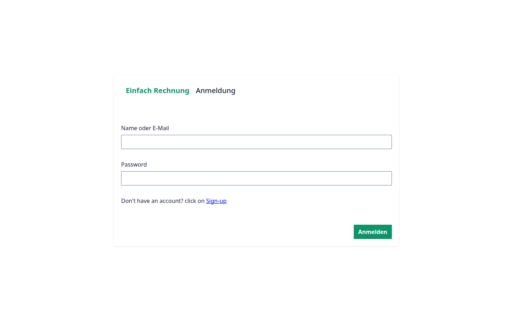
*Anmeldung mit Name oder E-Mail. Das Layout ist für alle Auth-Seiten identisch aufgebaut.*

Der Einstieg ist bewusst schlicht: ein Formular, klare Fehlermeldungen, keine Ablenkung. Technisch ist die Seite der Ort, an dem die Sicherheitsarchitektur sichtbar wird — nach erfolgreichem Login hält der Client nur den kurzlebigen Access-Token im Speicher, der langlebige Refresh-Token bleibt als `httpOnly`-Cookie außerhalb der Reichweite von JavaScript.

### Dashboard

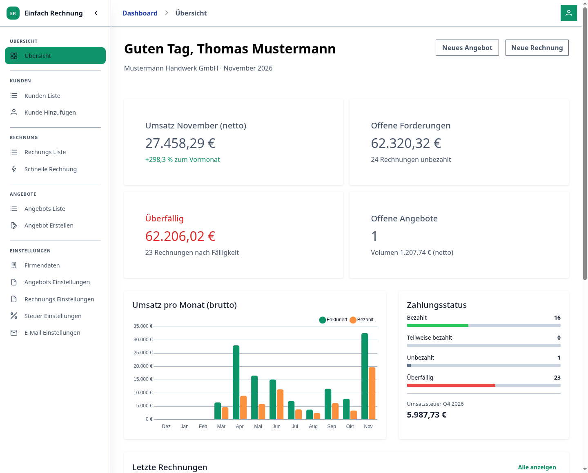
*Kennzahlen, Umsatzverlauf und Zahlungsstatus auf einen Blick — alles serverseitig berechnet.*

Das Dashboard beantwortet die Frage, die Excel nicht beantwortet: *Wie viel Geld steht gerade draußen?* Die Kennzahlen werden nicht im Browser zusammengerechnet, sondern per MongoDB-Aggregation ermittelt: Umsatz des laufenden Monats im Vergleich zum Vormonat, offene Forderungen, überfällige Beträge und offene Angebote. Der Balken-Chart stellt fakturierten und tatsächlich bezahlten Umsatz gegenüber — die Lücke dazwischen ist der eigentliche Informationsgehalt.

Der Zahlungsstatus ordnet jede Rechnung genau einer Kategorie zu (bezahlt, teilweise bezahlt, unbezahlt, überfällig). Diese Zuordnung passiert in der Pipeline über ein `$switch` und nicht im Frontend, damit Kennzahlen und Liste garantiert dieselbe Wahrheit zeigen.

### Kundenliste

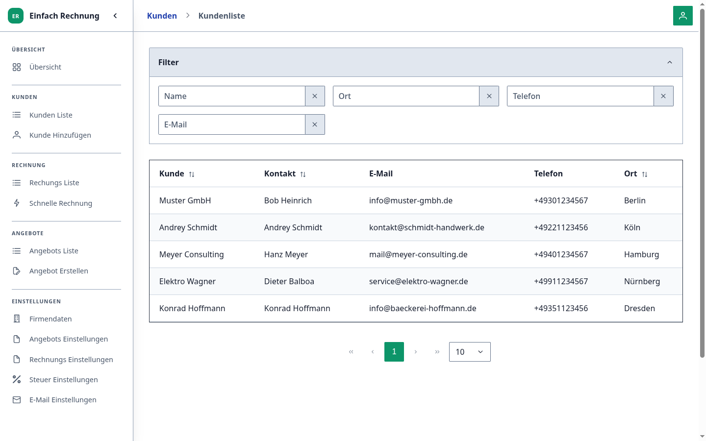
*Sortierbare Tabelle mit Filterleiste, Pagination und Direktsprung in den Datensatz.*

Die Kundenliste ist der Ort, an dem Datenmenge entsteht. Deshalb setzt sie auf eine sortierbare Tabelle mit serverseitiger Pagination statt auf Karten — und auf Filter, die man ein- und ausblenden kann, damit die Tabelle im Alltag nicht von Formularfeldern verdrängt wird.

### Kundendetails

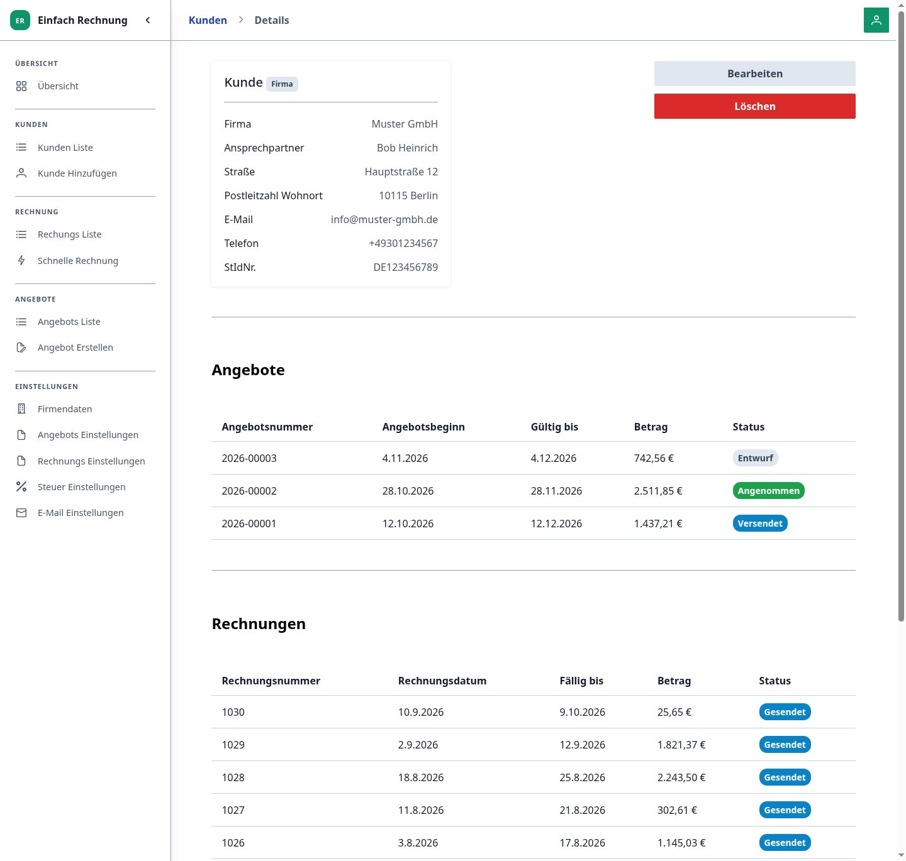
*Ein Datensatz, alle Beziehungen: Stammdaten, Angebote und Rechnungen eines Kunden.*

Die Detailseite ist der Beweis, dass die Daten normalisiert sind: Der Kunde existiert einmal, Angebote und Rechnungen verweisen darauf. Status erscheinen als Badge mit derselben Farb- und Label-Logik wie überall in der Anwendung, Beträge und Datumsangaben in deutschem Format. Wer einen Kunden ändert, sieht die Auswirkung sofort an den verknüpften Belegen.

### Kunde anlegen

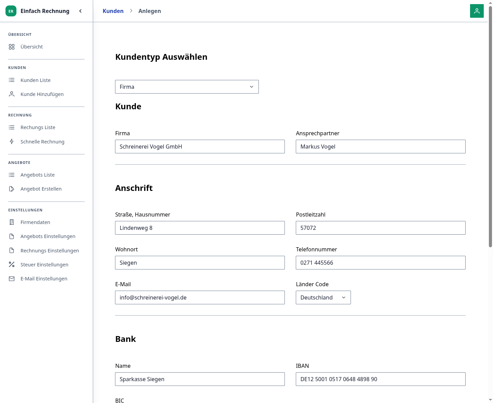
*Das Formular passt sich dem Kundentyp an: Firma oder Privatperson.*

Der Kundentyp entscheidet über die Felder: Eine Firma hat Ansprechpartner und USt-IdNr., eine Privatperson Vor- und Nachnamen. Bank- und Steuerdaten sind optional, weil sie nur für Belege gebraucht werden. Validierungsfehler kommen strukturiert vom Backend zurück und werden am jeweiligen Feld angezeigt — nicht als eine Sammelmeldung am Formularende.

### Rechnungsliste

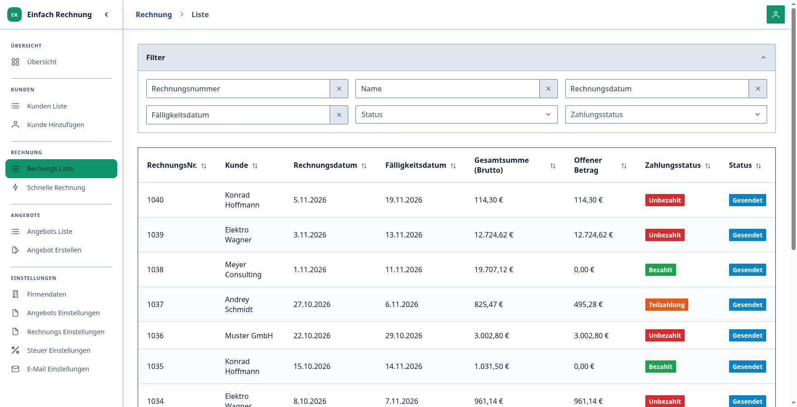
*Status und Zahlungsstatus sind getrennte Informationen und werden getrennt dargestellt.*

Eine Rechnung hat zwei Dimensionen: den Belegstatus (Entwurf, versendet, storniert) und den Zahlungsstatus (unbezahlt, Teilzahlung, bezahlt). Beides in einem Feld abzubilden, wäre bequem — und würde bei Teilzahlungen sofort falsch. Die Liste trennt die Dimensionen deshalb sichtbar und zeigt zusätzlich den noch offenen Betrag.

### Rechnung erstellen

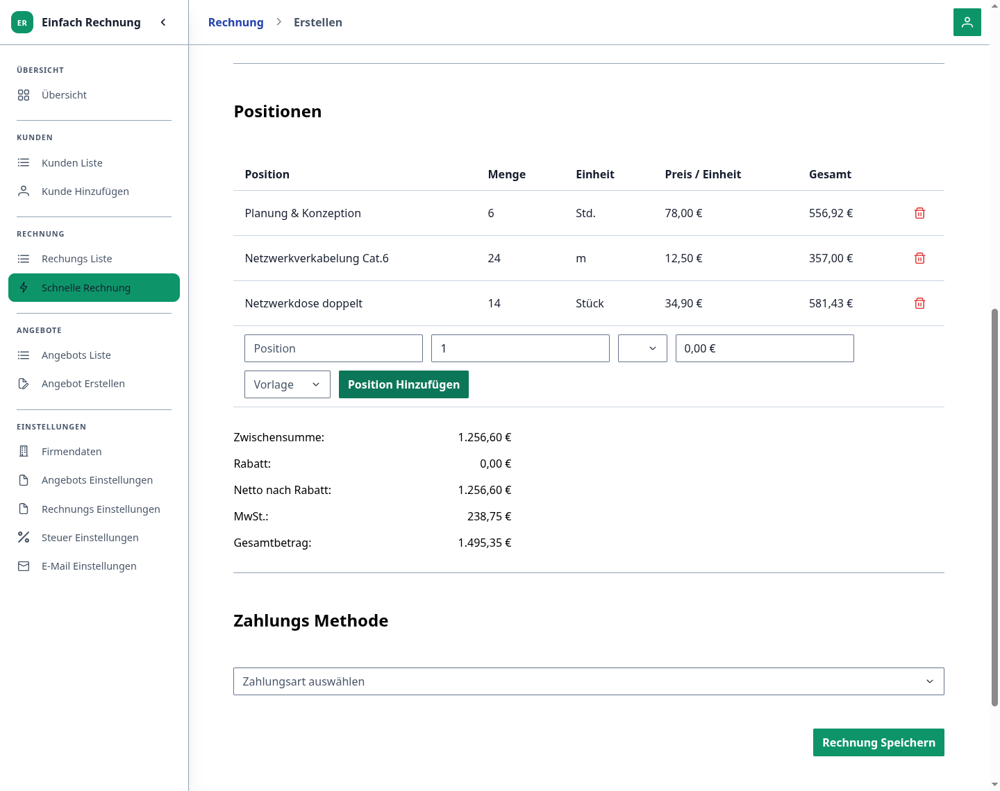
*Positionen, Rabatte und Summen werden beim Tippen live berechnet.*

Hier steckt die meiste Fachlogik: Positionen mit Menge, Einheit und Einzelpreis, Rabatte pro Position (prozentual oder als Festbetrag), Steuersatz pro Position, anschließend Zwischensumme, Netto nach Rabatt, Steueranteil und Gesamtbetrag. Die Berechnung liegt als reine Funktion vor und ist mit Unit-Tests abgesichert — inklusive Rundung, weil ein Cent Differenz am Ende des Monats auffällt.

### Rechnungsdetails

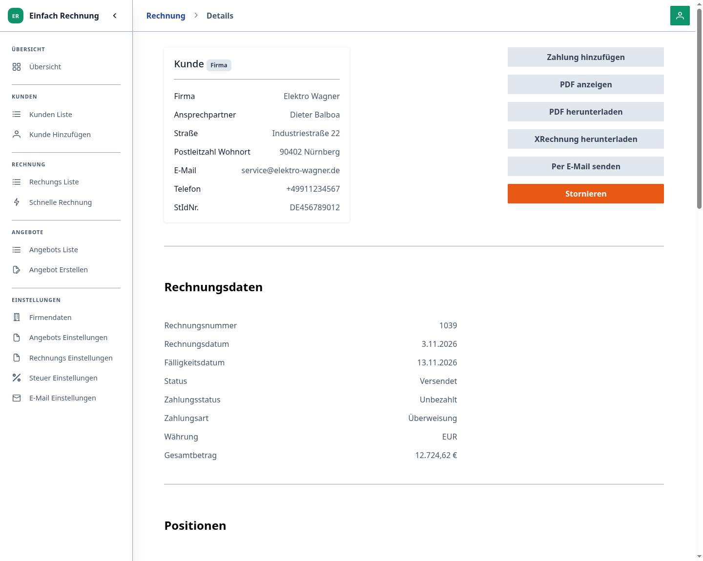
*Belegansicht mit allen Aktionen: Zahlung erfassen, PDF, XRechnung, Versand, Storno.*

Die Detailseite ist die Schaltzentrale eines Belegs. Kunde und Absender werden dabei als **Snapshot** gespeichert: Ändert der Betrieb später seine Adresse, bleiben bereits versendete Rechnungen unverändert — so, wie es rechtlich auch sein muss.

Neben dem PDF-Download gibt es einen **XRechnung-Export** als CII-XML für öffentliche Auftraggeber sowie das Erfassen von Teilzahlungen. Eine Zahlung darf den offenen Betrag nicht übersteigen; diese Regel steht als validierbare Funktion im Frontend und als Prüfung im Backend.

### Angebotsliste

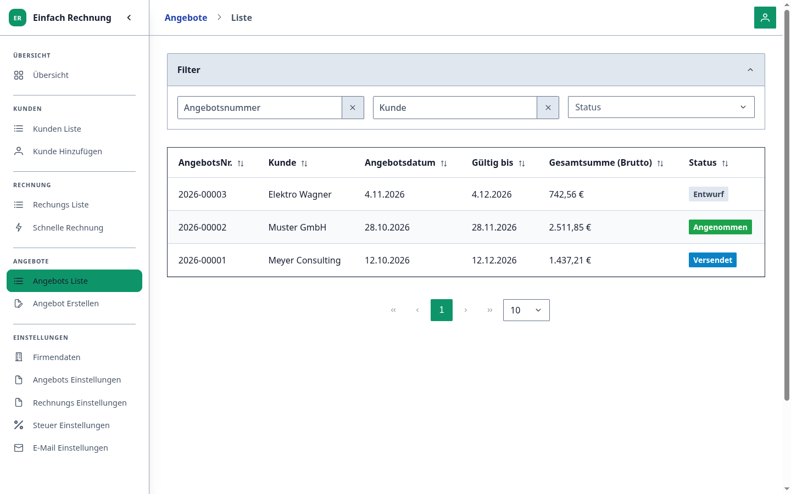
*Angebote mit Gültigkeitsdatum und Status — vom Entwurf bis zum angenommenen Angebot.*

Angebote sind keine Rechnungen mit anderem Titel: Sie haben ein Gültigkeitsdatum und einen eigenen Lebenszyklus (Entwurf → versendet → angenommen/abgelehnt/abgelaufen). Ein Cron-Job prüft die Gültigkeit und markiert abgelaufene Angebote automatisch, damit die Liste nicht lügt.

### Angebotsdetails

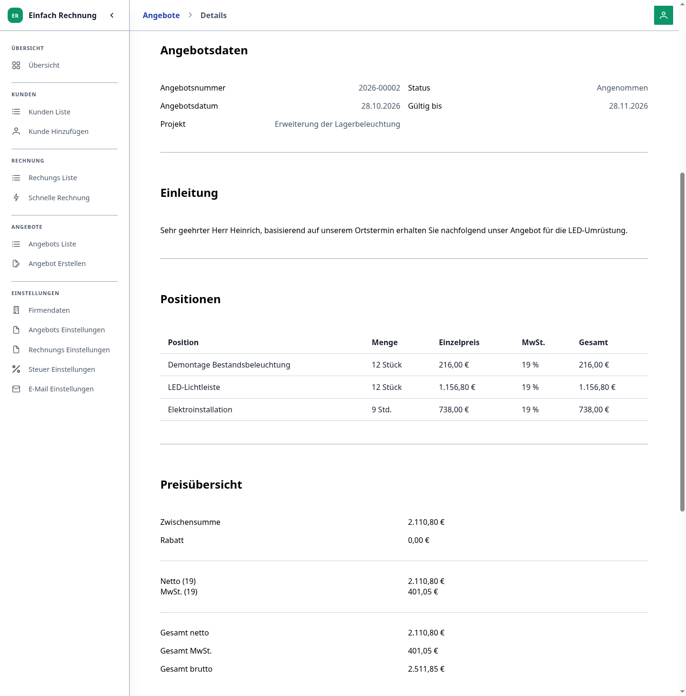
*Preisübersicht mit Steueraufteilung — Grundlage für das PDF, das der Kunde erhält.*

Die Angebotsansicht zeigt, was auch im PDF landet: Einleitungstext, Positionen, Schlussbemerkung und eine Preisübersicht mit Steueraufteilung. Optional lässt sich der Steuersatz pro Position einblenden — für Betriebe, die mit 7 % und 19 % gleichzeitig arbeiten, ist das der entscheidende Unterschied.

### Firmendaten

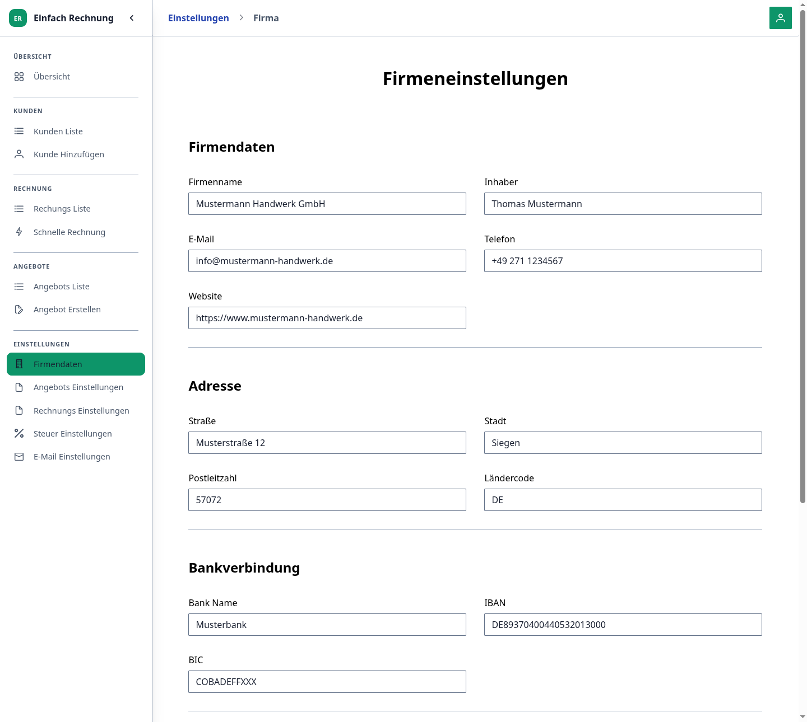
*Absenderdaten und Bankverbindung — die Quelle für jeden Beleg-Snapshot.*

Die Firmendaten sind Stammdaten mit Folgen: Sie landen als Snapshot auf jedem neuen Beleg, inklusive Bankverbindung, damit die Zahlungsinformationen auf der Rechnung stimmen. Deshalb ist dieses Formular bewusst nüchtern und vollständig.

### Rechnungseinstellungen

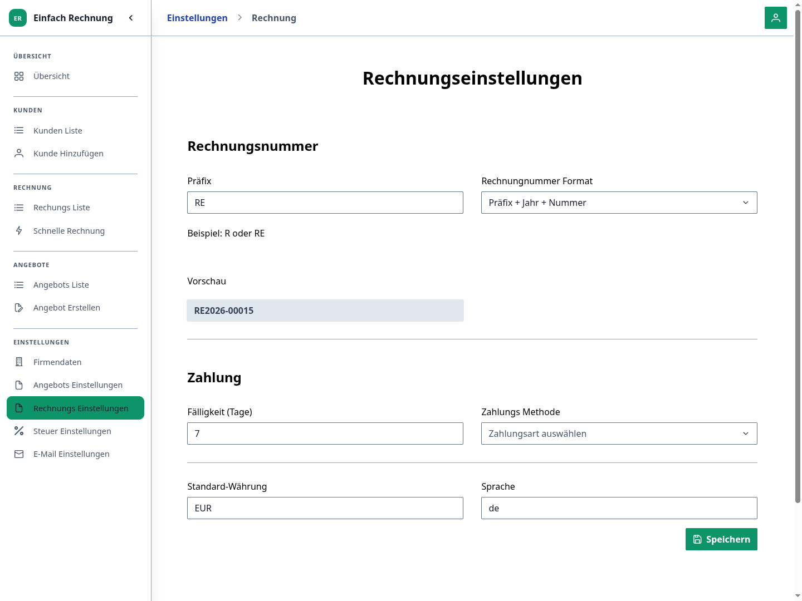
*Nummernformat mit Live-Vorschau, Zahlungsziel, Währung und Sprache.*

Der Nummernkreis ist die häufigste Fehlerquelle in Eigenlösungen. Hier ist er konfigurierbar (Präfix, Format, laufende Nummer) und zeigt eine Vorschau des nächsten Werts — man sieht vor dem Speichern, was als Nächstes vergeben wird.

### Registrierung

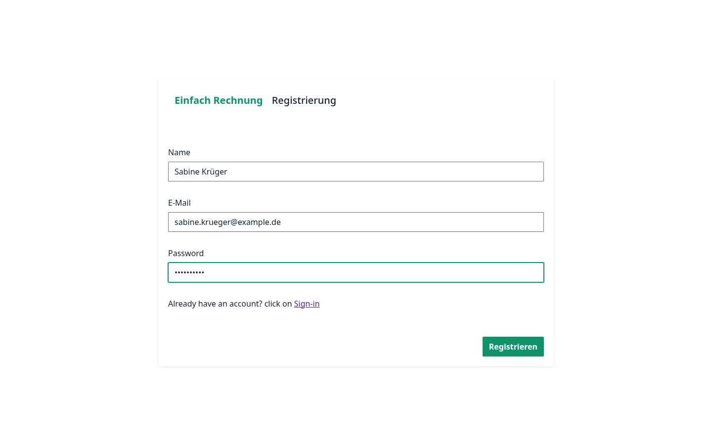
*Registrierung mit vorgeschaltetem E-Mail-Verfahren.*

Der Weg in die App führt über eine E-Mail-Bestätigung. Der Bestätigungstoken wird nicht im Klartext gespeichert, sondern als SHA-256-Hash mit 30 Minuten Gültigkeit. Vor der Bestätigung lehnt der Login den Zugang mit einem klaren Hinweis ab, statt eine halbfertige Session zu erzeugen.

### Responsive Ansicht

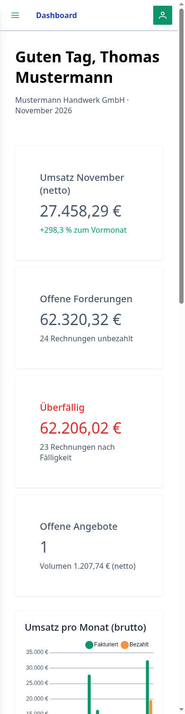
*Unter 1024 px wechselt die Navigation in ein Overlay, Karten stapeln sich vertikal.*

Die Anwendung ist nicht „mobile-first“, aber mobil benutzbar: Ab 1024 px klappt die Seitenleiste in ein Overlay, Tabellen werden scrollbar, Karten stapeln sich. Im Handwerk ist das kein Nice-to-have — Belege entstehen oft unterwegs.

---

## 6. Architektur- und Designentscheidungen

**Feature-Ordner statt technischer Schichten.** Ein Ordner pro Fachbereich, darin `api`, `services`, `store`, `ui`. Änderungen an Rechnungen bleiben damit in einem Verzeichnis, und die Import-Richtung ist eindeutig: UI kennt den Store, der Store kennt Services, Services kennen die API.

**Zwei Tokens, zwei Risiken.** Der Access-Token lebt nur im Speicher und verschwindet beim Neuladen. Der Refresh-Token ist `httpOnly`, `secure` und `sameSite`-geschützt. Ein XSS-Angriff kann damit keinen dauerhaften Zugang erbeuten.

**Snapshots statt Referenzen auf Belegen.** Kunde und Absender werden beim Erstellen eines Belegs kopiert. Das kostet Redundanz und spart ein Problem, das man sonst nie wieder loswird: nachträglich veränderte Rechnungen.

**Berechnungen einmal, nicht zweimal.** Summen, Steuern und Zahlungsstatus werden serverseitig berechnet; das Frontend rechnet nur für die Live-Vorschau mit derselben reinen Funktion. Zwei Implementierungen wären zwei Wahrheiten.

**Regeln als Funktionen.** Was „überfällig“ heißt oder wann eine Zahlung gültig ist, steht in `domainRules` als pure Funktion — testbar ohne Browser, wiederverwendbar in Liste und Detailansicht.

**Ein Ort für Formate.** Währung, Datum und die PrimeVue-Locale sind zentral konfiguriert (`shared/helpers`, `shared/config/primevue`). Komponenten formatieren nicht selbst — sonst zeigt jede Tabelle irgendwann ein anderes Datumsformat.

## 7. Qualitätssicherung

Vitest deckt die Stellen ab, an denen Fehler teuer sind: Berechnung der Belegsummen (inklusive Rabatten und Steueraufteilung), Zahlungsvalidierung, Ableitung des Zahlungsstatus und die Regeln für überfällige Rechnungen. Die Tests laufen ohne Browser, weil die Logik bewusst aus den Komponenten herausgezogen ist.

## 8. Herausforderungen und Learnings

- **Geldbeträge sind ein Rundungsproblem.** Steuer pro Position, Rabatt pro Position, Summe über alles: Sobald man in Cent rechnet und zwischendurch rundet, weicht das Ergebnis von der Erwartung ab. Die Lösung war eine einzige Berechnungsfunktion mit klaren Rundungspunkten und Tests, die genau diese Grenzfälle festhalten.
- **Status ist kein Textfeld.** „Offen“, „teilbezahlt“ und „überfällig“ sind keine gepflegten Werte, sondern ableitbar. Sie zu berechnen statt zu speichern hat mehrere Inkonsistenzen beseitigt — und macht Teilzahlungen erst korrekt.
- **Komponenten-Bibliothek heißt Konventionen lernen.** PrimeVue-Theming läuft über Presets und Design-Tokens, nicht über überschriebene CSS-Klassen. Wer mit älteren Anleitungen arbeitet, kämpft gegen das Framework statt damit.
- **Demo-Daten sind ein eigener Arbeitsauftrag.** Ein realistischer Datensatz (Kunden, Belege, Teilzahlungen, überfällige Posten) ist die halbe Präsentation — und deckt Datenfehler auf, die mit drei Testzeilen nie auffallen.

## 9. Nächste Schritte

- API-Tests für die Service-Schicht ergänzen.
- Angebot → Rechnung als Ein-Klick-Übernahme im Frontend sichtbar machen (die API kann es bereits).
- Mahnwesen: die vorhandene `canSendReminder`-Regel in einen geführten Ablauf bringen.
- Demo-Datensatz als Seed-Skript ausliefern, damit das Projekt lokal in einer Minute vorführbar ist.

## 10. Fazit

einfachRechnung ist kein Rechnungsgenerator, sondern ein kleines Beleg-System: Stammdaten, Belege, Zahlungen und die Ableitung des Zustands daraus. Der Aufwand lag weniger in der Oberfläche als in den Details, die man erst beim Benutzen bemerkt — Rundung, Teilzahlungen, Snapshots, Nummernkreise.

Genau diese Details sind der Grund, warum das Projekt als Portfolio-Beispiel taugt: Es zeigt nicht, dass ich ein Formular bauen kann, sondern wie ich fachliche Regeln in Code übersetze, der auch nach der zehnten Rechnung noch stimmt.
